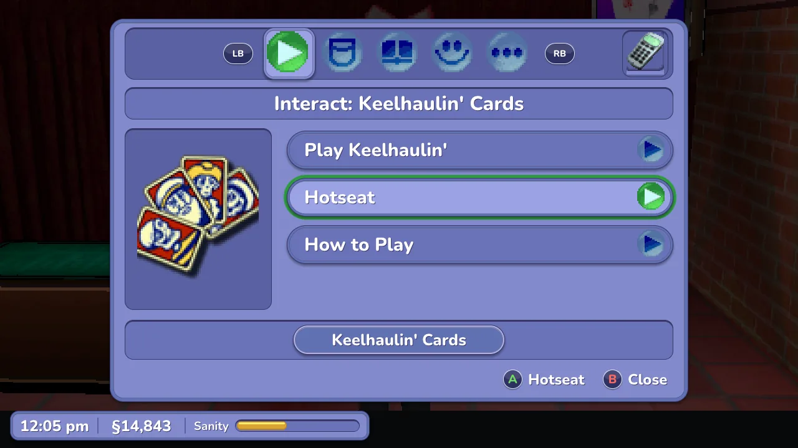
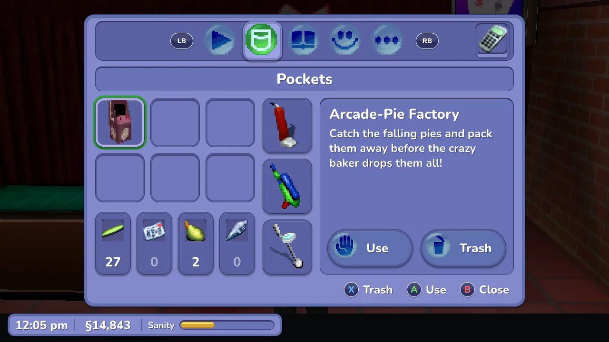
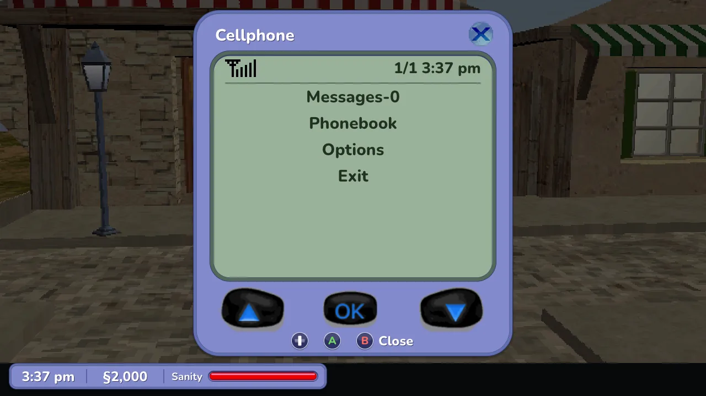
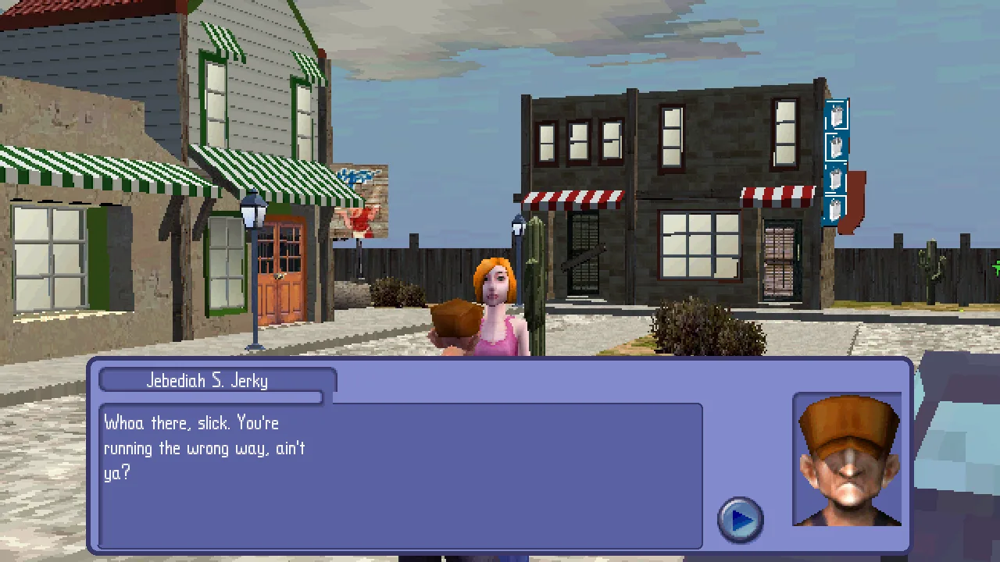
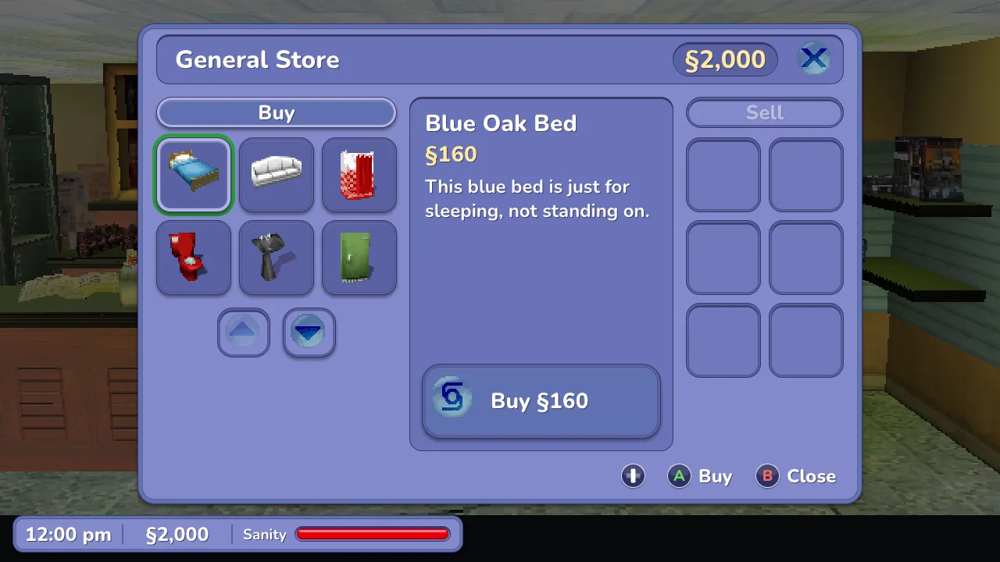
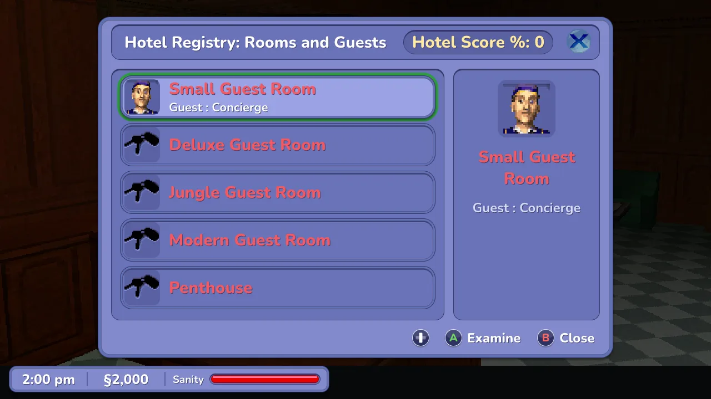
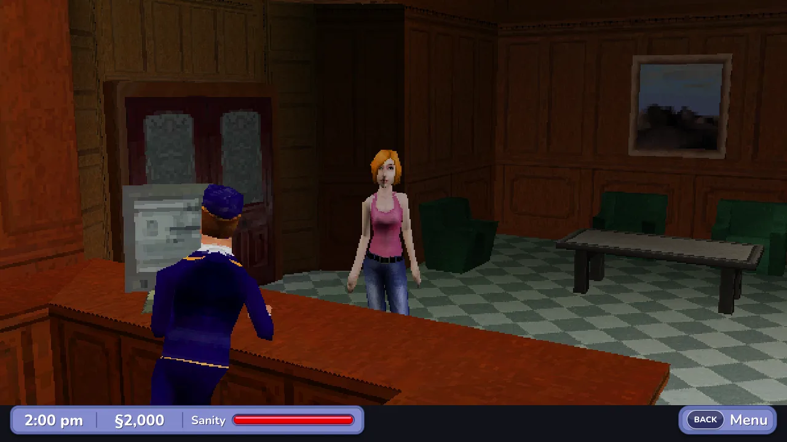
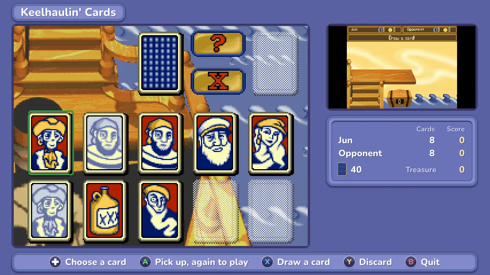
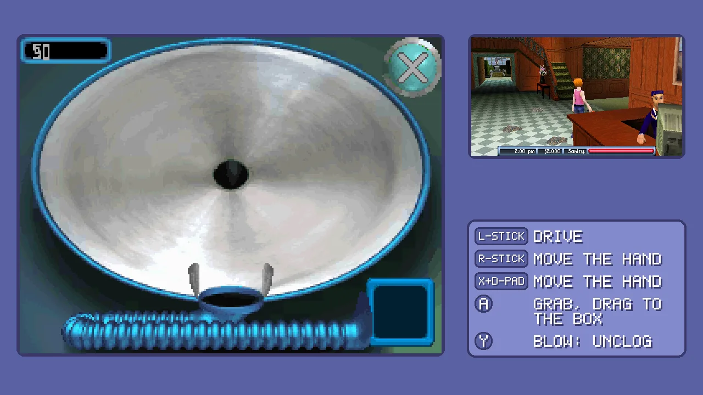

<h1 align="center">The Sims 2 DS, one screen</h1>

<p align="center">
  <strong>The Sims 2 for the Nintendo DS in a single window.</strong><br>
  Played like a console game: the town fills the window and every menu opens big on a button, with a controller or a keyboard, or with the mouse. No more two tiny stacked screens.
</p>

<p align="center">
  <a href="https://github.com/lborruto/sims2-ds-wide/actions/workflows/ci.yml"></a>
  <a href="LICENSE"></a>
</p>

<p align="center">
  
</p>

## What it does

- **Like a console game (CONSOLE, the default).** In town the 3D world fills the window, widescreen
  and sharper, with a small rail of the touch screen's tabs and phone beside it and the clock,
  money and Sanity meter in a sharp HD status bar (in the game's language). One button
  (Back, or E) opens the touch screen's menu big over the town; conversations are redrawn in
  HD over the whole world (the speaker's name, the game's own words in large type, their
  portrait; A turns the page); popups and the games get a big, clear picture of their own. Everything is played on the buttons, no mouse needed.
- **The whole town is HD, and played with a controller.** The status bar, the conversations,
  the menu's five tabs (Interact, Pockets, Goals, Relationships, Options), Give Gift, the save
  slots, the popups, the phone, the notes, the shop's catalogue, Build Rooms, the hotel's Registry and room pages, its music panel and the stat panel are redrawn sharp, in the game's own style, with
  its own icons and in the game's language (the words come from your copy of the game; with
  another version of it, the old pictures stay). Each has a focus the D-pad moves and buttons
  that say what A, X and B do: do an action, use or throw away an item, give a gift, read your
  goals and who likes you, turn the volume, save into a slot, answer a popup, call a friend, buy
  and sell, build a hotel room, check a guest in, pick the hotel's music, read your stats. The games (cards, vacuum, the social reactions) are still the game's own picture,
  laid out big. No mouse needed, though it works.
- **It follows the game.** CONSOLE asks the game itself what it is showing (town, a shop, a
  social game, the vacuum, the cards, the menus, Create-a-Sim), so the picture changes with
  nothing to set, and it never falls back to the bare two-screen layout. The intro, the title,
  the main menu, Settings and Load-a-Sim are redrawn for the controller too (A or Start takes the
  intro's last screen, A begins, the D-pad and A pick Create-a-Sim, Load-a-Sim, Settings or DS
  Wireless; in Settings LB / RB change page, Left / Right move the volume, the concept art opens
  with A and the credits roll; in Load-a-Sim A loads a saved Sim), and so is Create-a-Sim: your
  Sim big on the left, the game's pages on the right (more below); DS Wireless still shows the
  top screen and the touch screen big, each in its frame; a black load shows only the backdrop.
  This needs the European game (see [Good to know](#good-to-know)).
- **The old layouts are still there.** AUTO, FOCUS, SIDE and STACKED: SETTINGS > DISPLAY > LAYOUT.
- **The DS clock is your clock.** The game lives by the time of day (rooms take real hours,
  skill points come at set hours), so it reads your computer's time, also after a save state,
  and fast forward never runs it ahead: the game never sees its clock go back.
- **A microphone when the game asks for one.** Blow into it with a key (M: clearing the
  vacuum's filter, the music mixer); your real microphone is a setting.
- **The mouse is the stylus, and the camera.** Click the touch screen wherever it is shown;
  over the world, the wheel zooms and a right-button drag turns the camera.
- **Your keyboard or controller is the DS.** Every button has a key and a pad button, all
  remappable; a controller's right stick moves a cursor on the touch screen.
- **A pause menu.** Esc: save and load state, the settings (display, graphics, sound,
  controls), quit. Settings are kept between runs.
- **Sound that keeps up.** When the computer falls behind, the music stretches instead of
  crackling. Copies of your save are kept beside it, every half hour.

It runs the game on the [melonDS](https://melonds.kuribo64.net/) emulator core, built in.
It is an early version: see [Good to know](#good-to-know).

<p align="center">
  
  
</p>

<p align="center">
  
  
</p>

<p align="center">
  
  
</p>

<p align="center">
  
</p>

<p align="center">
  
</p>

## Get started

You need your own copy of the game, dumped from your cartridge (`.nds`). Nothing of the game
is included here.

**Download** from the [releases page](../../releases):

| Where you play | Download | Start it |
|---|---|---|
| **Windows** (64-bit) | `sims2-ds-wide-…-windows-x86_64.zip` | unzip, double-click `sims2wide.exe`; the first time, More info > Run anyway |
| **Mac** (Apple silicon or Intel, macOS 11+) | `sims2-ds-wide-…-macos-universal.zip` | unzip, move *Sims 2 DS Wide* to Applications; the first time, right click > Open |
| **Linux** (x86_64) | `sims2-ds-wide-…-linux-x86_64.tar.gz` | unpack, run `./sims2wide` (the file picker needs zenity or kdialog) |

It asks for your `.nds` when it starts, in the folder of the last one you chose. A ROM on the command
line (`sims2wide path/to/your-sims2.nds`) skips the question.

**Or build it** (a few minutes):

```bash
git clone --recursive https://github.com/lborruto/sims2-ds-wide.git && cd sims2-ds-wide
cmake -S . -B build -G Ninja -DCMAKE_BUILD_TYPE=Release
ninja -C build sims2wide
./build/sims2wide path/to/your-sims2.nds
```

You need CMake (3.21 or later), Ninja and a C++20 compiler (Xcode's command line tools on a
Mac). On Linux, SDL's development packages too: [CONTRIBUTING.md](CONTRIBUTING.md#set-up) lists
them.

## Controls

Keyboard and controller do the same things. The DS's buttons are placed by position, not by
letter, so an AZERTY or QWERTZ keyboard has them in the same places as QWERTY.

| Key | Controller | Does |
|---|---|---|
| Arrows | D-pad or left stick | walk (town); move the highlight (menus, games) |
| X / Z / S / A (AZERTY: X / W / S / Q) | A / B / X / Y (as labelled) | the DS's A / B / X / Y |
| Q / W (AZERTY: A / Z) | LB / RB | L / R: turn the camera in town; switch tabs while the menu is open |
| Enter / Right Shift | Start / left stick click | Start / Select |
| E | Back (let go) | open the touch screen's menu (the PANEL); B closes it |
| Esc | Guide, or Start + Back | the frontend's pause menu: save states, settings, quit |
| M (hold) | | blow into the microphone |
| Tab | right stick click | swap which screen is big (the old layouts) |
| Space (hold) | RT | fast forward |
| F5 / F7 | | save state / load state (beside the ROM, `.quick.st`) |
| F11 / F12 | | fullscreen / screenshot of both screens (beside the ROM, `-shot.png`) |
| 0 to 4 | | layout: AUTO / FOCUS / SIDE / STACKED / CONSOLE |
| Mouse | right stick + LT (the cursor; A too wherever the cursor is the way to touch: DS Wireless, the furniture editor) | the touch screen, wherever it is shown |
| Mouse wheel / right button drag, over the world | | zoom / turn the camera |

Every row but the last few can be changed in the pause menu (SETTINGS > CONTROLS > KEYS AND
BUTTONS): choose the action, press the key or button you want. Xbox, PlayStation and Switch
controllers are known by their own button names.

**In town** the buttons are the DS's. **The menu** (phone, tabs, shop, the rest of the touch
screen) opens on the PANEL button; the D-pad moves, A taps, LB / RB switch tabs, B closes. On the
Interact tab, A does the highlighted action and Left / Right pick the next thing or person nearby.
In Pockets, A uses the highlighted item and X throws it away (press X twice: the first only asks,
the bin turns green; moving away cancels). In Give Gift, A gives the highlighted item and B closes. In Goals and
Relationships, Up / Down move the game's own selection; in Options, Left / Right turn a volume
up or down a notch, and A on Save opens the save slots (A saves into the highlighted one: an
empty slot at once, a used one after the game asks, A yes, B no; B closes).
In the shop, A on an item picks it (a shop item to buy, one of yours to sell, with its price),
A on the simoleon button buys or sells it (greyed when the game would not), Up / Down past the
list scroll it, B closes. In Build Rooms, A on a room asks the game's question (its permit and
the money left shown first; the focus starts on No, so a stray double press never spends), Right
and A buy it, A on No or B goes back (B on the list closes). In the hotel's
Registry, A on a room shows its page (who stays, their mood, when they leave, what the room earns
a day; A on a line explains it), and when a guest checks in, A on a free room gives it to them;
B goes back. On a music panel, A plays the highlighted song (the room keeps it), Up / Down past
the list scroll it, B closes. On the stat panel, A opens a page, LB / RB (or Left / Right on a
page) go to the previous / next one, B goes back to the first page, then closes.
**In Create-a-Sim** LB / RB change page and Start goes to the next one; the right stick (or the
mouse's right drag) turns your Sim. On the first page the D-pad and A type the name on the
game's keyboard (seven letters at most), Y erases a letter and X changes the letters (ABC, abc,
123!); the gender and skin buttons are above it. Hair, face and clothes are picked with the D-pad
and A (Left / Right past the edge show more, as the game's arrows do). On the last page pick an
aspiration, then A on the tick starts the game; B (or the cross) goes back to the title.
The phone's Up / Down / A are the phone's own buttons (A on a row goes there and presses OK); B
hangs up. **A conversation** goes on with A. **Popups** (tips, goals, Game Paused) answer to A or
B; a question (Quit?) takes A for yes and B for no; when a popup opens over the menu, the menu
comes back on the same row after it. A note closes on A or B.

**The activities** are played on the buttons too, with a box of hints beside them:

| Activity | Key | Controller | Does |
|---|---|---|---|
| Social reaction | Left / Up / Right | D-pad or left stick | the left / top / right answer |
| | X | A | the chosen answer again |
| Keelhaulin' Cards | Arrows | D-pad or left stick | choose a card (or the deck, the discard pile, ? and X) |
| | X | A | pick the card up; again: play it on the stairs |
| | S | X | draw from the deck |
| | A | Y | discard the chosen card |
| | Z | B | quit (then X / A: yes, Z / B: no) |
| Vacuum | Arrows | left stick (or D-pad) | drive |
| | S + arrows | right stick (or X + D-pad) | move the hand over the bowl |
| | X (hold) | A (hold) | grab a find with the hand and drag it to the box |
| | A (hold) | Y (hold) | blow: clears a clogged filter (a tap is enough; works with any microphone setting) |

<p align="center">
  
  
</p>

The game's own save goes beside the ROM, with the same name and `.sav`. A `.sav` from another
emulator or a flash cart works if you put it there. A copy is made in `backups/` beside it when
the program starts and every half hour (the last eight are kept).

## Settings

Esc opens the pause menu; SETTINGS has four pages:

| Page | Settings |
|---|---|
| DISPLAY | fullscreen (F11), smooth scaling, layout |
| GRAPHICS | 3D resolution, widescreen world, 60 fps |
| SOUND | volume, sound during fast forward (muted, or at normal pitch skipping ahead) |
| CONTROLS | stick touch cursor, microphone (off, the blow key, the real one), keys and buttons |

<p align="center">
  
</p>

They are kept in `settings.ini` in your user folder (the window's size too): on Windows
`%APPDATA%\sims2-ds-wide`, on a Mac `~/Library/Application Support/sims2-ds-wide`, on Linux
`~/.local/share/sims2-ds-wide`. Delete it to start over.

## Layouts

| Layout | What you see |
|---|---|
| **CONSOLE** (default) | the window as a console game: the world big (widescreen, sharper, 60 fps), the touch screen's menu, conversations, popups and games laid out big, with hints; the title, Create-a-Sim and the menus redrawn big |
| **AUTO** | FOCUS in town (the touch screen big during a social game, in the shop's catalogue or Build Rooms), SIDE everywhere else |
| **FOCUS** | the world big, the touch screen at twice its size over the world's right edge, a little see-through (Tab makes the touch screen the big one instead) |
| **SIDE** | both screens side by side |
| **STACKED** | as on the DS, one above the other |

Change it in SETTINGS > DISPLAY > LAYOUT or with the 0 to 4 keys; or start with one:
`--layout focus`. Run `sims2wide --help` to see every option, including the headless mode used
to study the game's screens ([CONTRIBUTING.md](CONTRIBUTING.md#studying-the-screens)).

## Looks

Three options make the game look better without changing it. They are on by default; switch them off
in SETTINGS > GRAPHICS. The options below turn them on for one run.

| Option | What it does | On the command line |
|---|---|---|
| **Sharper 3D** | draws the 3D world 2, 3 or 4 times sharper | `--res3d 3` (default 2) |
| **Widescreen** | shows more of the town left and right, 16:9 instead of 4:3; the status bar stays in the middle | `--wide` |
| **60 fps** | adds in-between frames: the game draws its 3D at 30 frames a second | `--interp` |

<p align="center">
  
</p>

Widescreen is a stretch for a game made for 4:3: the game is told to draw a wider view, and it
does in town, in conversations and in Create-a-Sim, but in places not checked yet something
the game never meant to be seen can show at the edges. Each one costs speed; all three together still run well over full speed on a recent Mac.

## Good to know

- **An early version.** Town, conversations, Create-a-Sim, the shop, Build Rooms, the hotel's
  lobby, basement, Registry and music, the social games, the vacuum and the casino's card game are
  checked; not everything the game has is yet.
- **A few screens are still the game's own picture.** The furniture editor of a hotel room, and
  any screen CONSOLE has no HD page for, are drawn big with the stick as a cursor (the right
  stick moves it, A touches), and a hint box says so.
- **The side panel covers a strip of the world.** In FOCUS the touch screen lies over the
  world's right edge (the status bar stays clear). Tab or SIDE (2) when you want all of it. (CONSOLE has no such strip.)
- **Widescreen is on by default.** Switch it off in SETTINGS > GRAPHICS if a place shows something odd at the edges. See [Looks](#looks).
- **Most minigames not checked yet.** The social reactions, the shop, Build Rooms and the vacuum
  (its bowl comes big; drag the finds into the bag with the mouse; hold M to blow a clogged
  filter clear) and the casino's cards are; painting, the music mixer and the rest are not. If one shows up wrong, Tab swaps the big screen and 2 shows
  both.
- **CONSOLE needs the European game** (code `ASJP`): it reads the game's screens from its memory,
  and that map is the European one. With another version, CONSOLE falls back to recognising the
  screens by their pixels (as before) and the program says so. The American one should work
  otherwise; its automatic layout is untested. A save from the American game loads in the European one.
- **Not signed by Apple or Microsoft.** Hence the extra click the first time. Once the project
  is public, each download comes with a build attestation from GitHub instead
  ([SECURITY.md](SECURITY.md)).

## Screens it does not know yet

When the game shows a screen CONSOLE has no name for, it frames it as best it can and, once for
that screen, saves a picture and a save state into a `captures` folder in your user folder (the
one `settings.ini` is in; at most 20 a run, 200 in all, never twice the same screen). If you
see odd screens, send the `.png` files and what you were doing in an
[issue](https://github.com/lborruto/sims2-ds-wide/issues). Never send the `.st` files: a save
state holds a copy of the game's memory.

## Help and docs

| I want to… | Read |
|---|---|
| Build it, hack on it, see how it works | [CONTRIBUTING.md](CONTRIBUTING.md) |
| Know what it reads and writes, report a vulnerability | [SECURITY.md](SECURITY.md) |
| See what changed | [CHANGELOG.md](CHANGELOG.md) |

Found a bug? [Open an issue](https://github.com/lborruto/sims2-ds-wide/issues) with your system,
the version and what the program printed in the terminal. Never attach a ROM, a save or a save
state.

## Licence and credits

GPLv3, see [LICENSE](LICENSE), as melonDS. Built on [melonDS](https://github.com/melonDS-emu/melonDS)
1.1, [SDL2](https://www.libsdl.org/), [stb_image_write and stb_truetype](https://github.com/nothings/stb) and
[tinyfiledialogs](https://sourceforge.net/projects/tinyfiledialogs/). The interface's font is
[Nunito](https://github.com/googlefonts/nunito) (SIL Open Font License 1.1,
[assets/fonts/OFL.txt](assets/fonts/OFL.txt)).
The idea comes from [Pokémon FullDex](https://github.com/mamesj/pokemon-fulldex), which does
this for the DS Pokémon games; `src/platform.cpp`, the remappable controls (`src/controls.*`),
the menu's drawing and font (`src/ui.*`) and the sound stretching (`src/audiostretch.h`) are
adapted from it, and the sharper and widescreen 3D and the in-between frames are ported from its
renderer (`src/melonds_ext/`, `patches/melonDS/`), GPLv3 too.

## Not affiliated, no warranty

An independent, unofficial project. It is not made, endorsed or supported by Electronic Arts,
Maxis, Nintendo or the melonDS team; the names are theirs, used only to say what it works with.
Bring your own copy, dumped from a cartridge you own. No warranty of any kind: keep a copy of
your save.
