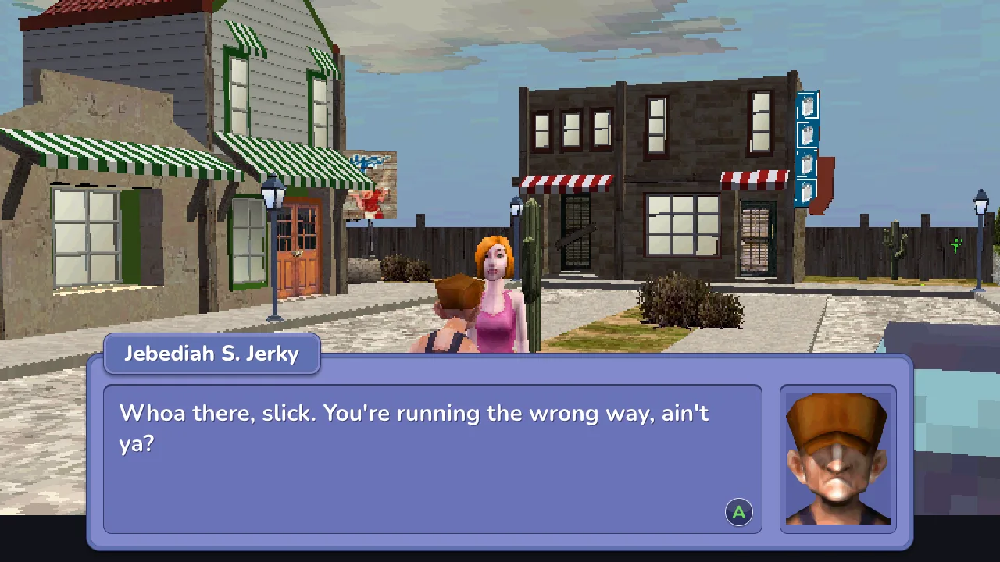
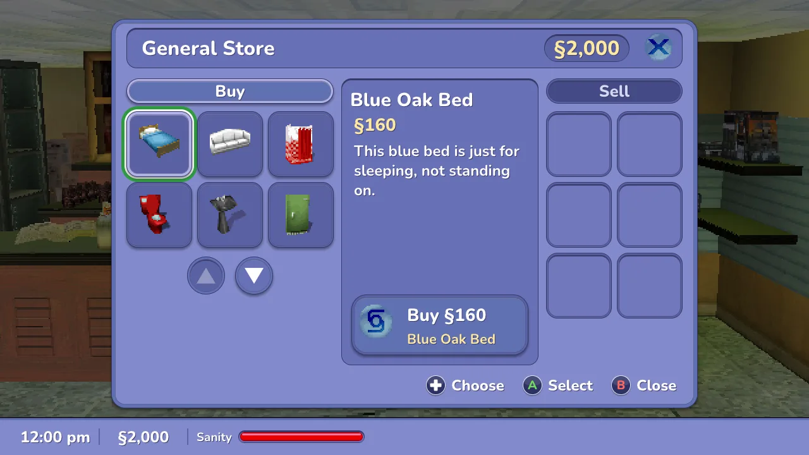
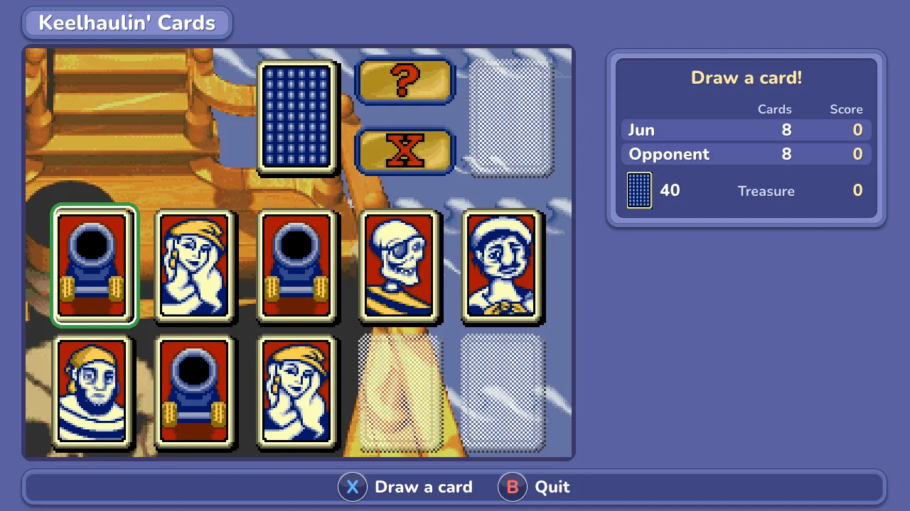

<h1 align="center">The Sims 2 DS, one screen</h1>

  <strong>The Sims 2 for the Nintendo DS, played on your computer like a console game.</strong> 
  One window, a controller in your hands, and every DS menu redrawn sharp and big.

  
  

  

## What you get

- **One window, no more two tiny screens.** The town fills it, widescreen and sharper, at 60
  frames a second. Near someone or something, a plate says what A does there.
- **The DS menus in HD, in the game's own style.** Its colours, its icons and its own words:
  pockets, goals, the phone, the shop, the hotel, Create-a-Sim, conversations and popups, at a
  size that suits your screen.
- **Played with a controller only.** Xbox, PlayStation, Switch, 8BitDo, the Steam Deck and the
  Steam Controller. The right stick is the camera, and every minigame works on the buttons, with
  hints on screen.
- **A pause menu and a place to start.** Four save states with pictures (and Undo), your
  settings, your buttons; *Continue* picks up exactly where you quit.
- **Five languages**: English, French, German, Italian and Spanish, from your copy of the game,
  following your computer's.
- **Your saves are safe.** The game saves as on the DS, and a backup copy is made every half hour.

## A look around

<table>
  <tr>
    <td></td>
    <td></td>
  </tr>
  <tr>
    <td></td>
    <td></td>
  </tr>
  <tr>
    <td></td>
    <td></td>
  </tr>
</table>

## Get started

1. **Have your own copy of the game.** Dump it from your own cartridge of the European version
   (an `.nds` file). Nothing of the game is included here.
2. **Download** the program for Windows, Mac or Linux from the [releases page](../../releases)
   and unzip it.
3. **Open it** (`sims2wide`, or *Sims 2 DS Wide* on a Mac), choose your game file or drop it on
   the window. Next time, *Continue* starts where you quit.

The program isn't signed, so the first time Windows wants *More info > Run anyway*, and a Mac a
right click > *Open*.

**On Steam or a Steam Deck:** in Steam, *Add a Game > Add a Non-Steam Game*, pick the program and
keep Steam Input on with the default Gamepad layout.

Want to build it yourself? See [CONTRIBUTING.md](CONTRIBUTING.md#set-up).

## Controls

The buttons on screen always show what they do, with your controller's own labels.

| Controller | Keyboard | Does |
|---|---|---|
| Left stick or D-pad | Arrows | walk; move around menus |
| A / B | X / Z | do, choose / go back, close |
| Right stick | Q / W, S / A | turn the camera, zoom |
| Back | E | open the menu (pockets, goals, phone…) |
| LB / RB | Q / W | switch menu tabs and pages |
| Start + Back | Esc | pause: save states, settings, quit |
| RT (hold) | Space (hold) | fast forward |
| Minigames | | their buttons are shown in a bar under each one |

The mouse works too: click anything, scroll to zoom, right-drag to turn the camera. Every button
can be changed in the pause menu. The [manual](docs/manual.md) has every control, minigame by
minigame.

## FAQ

**Which version of the game works?**
The European one. Other versions start, but the menus stay the DS's own small pictures.

**Which language does it use?**
Your computer's, if the game has it (English, French, German, Italian or Spanish). Change it on the
launch panel or in the pause menu's Settings; it applies the next time the game starts.

**Where is my save?**
Beside your game file, with the same name and `.sav`. Backups go in `backups/` next to it. A save
from another emulator or a flash cart works if you put it there. If that folder can't be written,
the save goes to the settings folder and the pause menu says where.

**The menus are too big, or too small.**
Pause, *Settings > Display > Interface size*: Auto follows your screen, or pick 60 to 150 %.

**It's blurry, or slow.**
Pause, then *Settings > Graphics*: *3D resolution* sets how sharp the 3D is, and widescreen and 60 fps can be
switched off (*Battery saver* holds the 3D at 1x and 30 fps on a laptop; widescreen stays as set). If it runs too fast, check you aren't holding
fast forward.

**It pauses when I click another window.**
On purpose: *Settings > Sound > Pause in the background* changes it. The Steam overlay does not pause it.

**Is DS Wireless supported?**
No. Trading and wireless games need a second DS; the game's screen says so and B leaves it.

## Help and contributing

- The [manual](docs/manual.md): every control, the pause menu, the settings, the layouts and what
  is still rough.
- Found a bug? [Open an issue](https://github.com/lborruto/sims2-ds-wide/issues) with your
  system and what happened. Never attach a game file, a save or a save state.
- Want to help? [CONTRIBUTING.md](CONTRIBUTING.md). Security: [SECURITY.md](SECURITY.md).
  What changed: [CHANGELOG.md](CHANGELOG.md).

## Licence and credits

GPLv3, see [LICENSE](LICENSE), as melonDS. It runs the game on
[melonDS](https://github.com/melonDS-emu/melonDS) 1.1, with [SDL2](https://www.libsdl.org/),
[stb](https://github.com/nothings/stb), [tinyfiledialogs](https://sourceforge.net/projects/tinyfiledialogs/)
and [xBRZ](https://sourceforge.net/projects/xbrz/) (GPLv3, the menus' Smooth pictures). The font
is [Nunito](https://github.com/googlefonts/nunito) ([OFL](assets/fonts/OFL.txt)); the controller
mappings are [SDL_GameControllerDB](https://github.com/mdqinc/SDL_GameControllerDB)
([zlib](assets/controllers/LICENSE.txt)). The idea, the controls, the sound stretching and the
sharper, widescreen 3D come from [Pokémon FullDex](https://github.com/mamesj/pokemon-fulldex),
GPLv3 too.

## Not affiliated, no warranty

An independent, unofficial project, not made, endorsed or supported by Electronic Arts, Maxis,
Nintendo or the melonDS team; the names are theirs, used only to say what it works with. Bring
your own copy, dumped from a cartridge you own. No warranty: keep a copy of your save.
