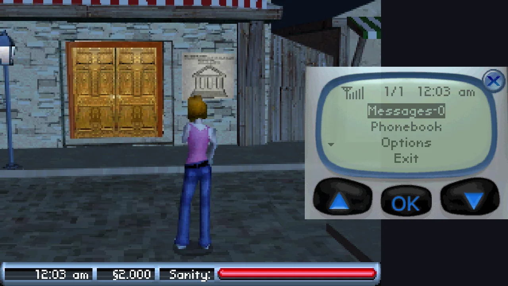
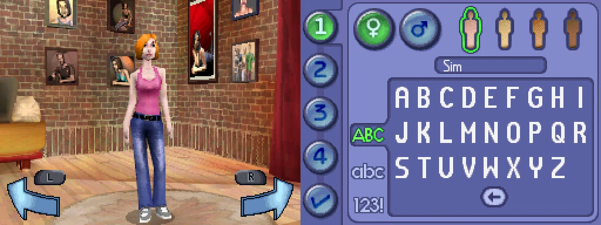
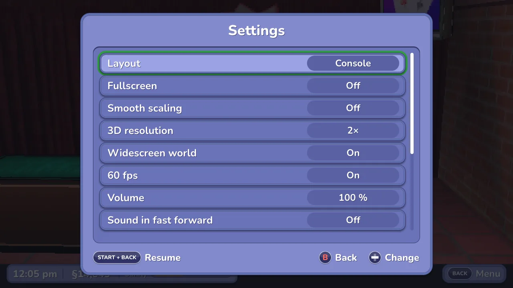
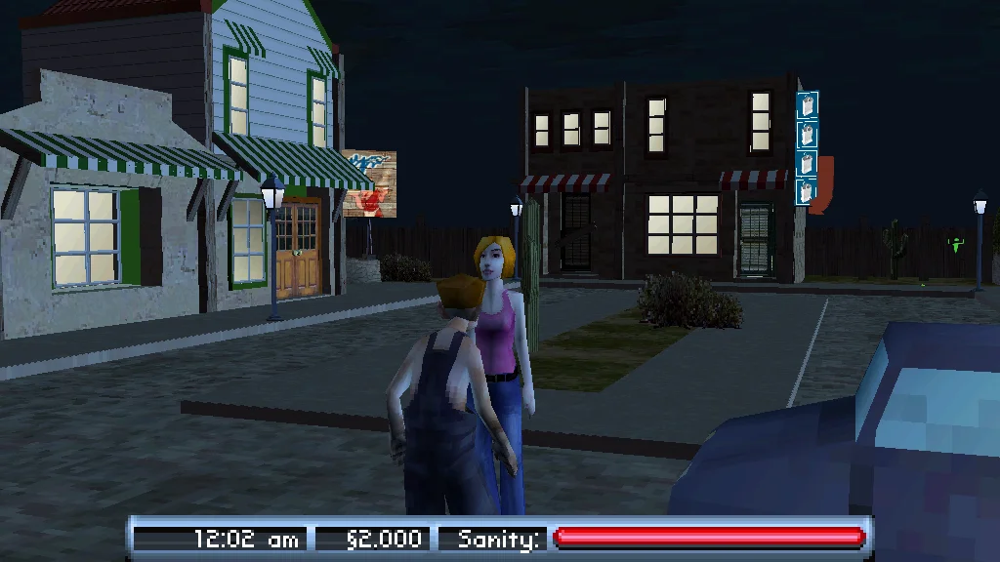

<h1 align="center">The Sims 2 DS, one screen</h1>

<p align="center">
  <strong>The Sims 2 for the Nintendo DS in a single window.</strong><br>
  The town fills the screen, the touch screen's menus sit beside it and work with the mouse. No more two tiny stacked screens.
</p>

<p align="center">
  <a href="https://github.com/lborruto/sims2-ds-wide/actions/workflows/ci.yml"></a>
  <a href="LICENSE"></a>
</p>

<p align="center">
  
</p>

## What it does

- **One window, the right screen big.** In town, the 3D world takes the window and the touch
  screen's panel (Interact, Pockets, Goals, Relationships, Options, the phone, conversations)
  sits beside it. When the game moves to the touch screen (a social reaction to pick in time,
  the shop's catalogue, Build Rooms) that one takes the window. Title, menus and Create-a-Sim
  show both screens side by side, since both matter there.
- **It switches on its own.** It sees what the game shows (its status bar, a social game, a
  shop) from the screens themselves, so the layout follows the game with nothing to set.
- **The DS clock is your clock.** The game lives by the time of day (rooms take real hours,
  skill points come at set hours), so it reads your computer's time, also after a save state,
  and fast forward never runs it ahead: the game never sees its clock go back.
- **A microphone when the game asks for one.** Blow into it with a key (M: clearing the
  vacuum's filter, the music mixer); your real microphone is a setting.
- **The mouse is the stylus, and the camera.** Click the touch screen wherever it is shown;
  over the world, the wheel zooms and a right-button drag turns the camera.
- **Your keyboard or controller is the DS.** Every button has a key and a pad button, all
  remappable; a controller's right stick moves a cursor on the touch screen.
- **A pause menu.** Esc: save and load state, the settings (display, graphics, sound,
  controls), quit. Settings are kept between runs.
- **Sound that keeps up.** When the computer falls behind, the music stretches instead of
  crackling. Copies of your save are kept beside it, every half hour.

It runs the game on the [melonDS](https://melonds.kuribo64.net/) emulator core, built in.
It is an early version: see [Good to know](#good-to-know).

<p align="center">
  
</p>

## Get started

You need your own copy of the game, dumped from your cartridge (`.nds`). Nothing of the game
is included here.

**Download** from the [releases page](../../releases):

| Where you play | Download | Start it |
|---|---|---|
| **Windows** (64-bit) | `sims2-ds-wide-…-windows-x86_64.zip` | unzip, double-click `sims2wide.exe`; the first time, More info > Run anyway |
| **Mac** (Apple silicon or Intel, macOS 11+) | `sims2-ds-wide-…-macos-universal.zip` | unzip, move *Sims 2 DS Wide* to Applications; the first time, right click > Open |
| **Linux** (x86_64) | `sims2-ds-wide-…-linux-x86_64.tar.gz` | unpack, run `./sims2wide` (the file picker needs zenity or kdialog) |

It asks for your `.nds` when it starts, in the folder of the last one you chose. A ROM on the command
line (`sims2wide path/to/your-sims2.nds`) skips the question.

**Or build it** (a few minutes):

```bash
git clone --recursive https://github.com/lborruto/sims2-ds-wide.git && cd sims2-ds-wide
cmake -S . -B build -G Ninja -DCMAKE_BUILD_TYPE=Release
ninja -C build sims2wide
./build/sims2wide path/to/your-sims2.nds
```

You need CMake (3.21 or later), Ninja and a C++20 compiler (Xcode's command line tools on a
Mac). On Linux, SDL's development packages too: [CONTRIBUTING.md](CONTRIBUTING.md#set-up) lists
them.

## Controls

| Key | Controller | Does |
|---|---|---|
| Arrows | D-pad or left stick | +Control Pad |
| X / Z / S / A (AZERTY: X / W / S / Q) | A / B / X / Y (as labelled) | A / B / X / Y |
| Q / W (AZERTY: A / Z) | LB / RB | L / R |
| Enter / Right Shift | Start / Back | Start / Select |
| Mouse | right stick + LT (the cursor) | the touch screen, wherever it is shown |
| Mouse wheel, over the world | | zoom in / out (the game's X / Y) |
| Right button drag, over the world | | turn the camera (the game's L / R) |
| M (hold) | | blow into the microphone |
| Esc | Guide, or Start + Back | the pause menu: save states, settings, quit |
| Tab | right stick click | swap which screen is big |
| Space (hold) | RT | fast forward |
| F5 / F7 | | save state / load state (beside the ROM, `.quick.st`) |
| 0 / 1 / 2 / 3 | | layout: AUTO / FOCUS / SIDE / STACKED |
| F11 | | fullscreen |
| F12 | | screenshot of both screens (beside the ROM, `-shot.png`) |

The DS's buttons are placed by position, not by letter: on an AZERTY or QWERTZ keyboard they
sit in the same places as on QWERTY. Every row but the last four can be changed in the menu (SETTINGS > CONTROLS > KEYS AND
BUTTONS): choose the action, press the key or button you want. Xbox, PlayStation and Switch
controllers are known by their own button names.

The game's own save goes beside the ROM, with the same name and `.sav`. A `.sav` from another
emulator or a flash cart works if you put it there. A copy is made in `backups/` beside it when
the program starts and every half hour (the last eight are kept).

## Settings

Esc opens the pause menu; SETTINGS has four pages:

| Page | Settings |
|---|---|
| DISPLAY | fullscreen (F11), smooth scaling, layout |
| GRAPHICS | 3D resolution, widescreen world, 60 fps |
| SOUND | volume, sound during fast forward (muted, or at normal pitch skipping ahead) |
| CONTROLS | stick touch cursor, microphone (off, the blow key, the real one), keys and buttons |

<p align="center">
  
</p>

They are kept in `settings.ini` in your user folder (the window's size too): on Windows
`%APPDATA%\sims2-ds-wide`, on a Mac `~/Library/Application Support/sims2-ds-wide`, on Linux
`~/.local/share/sims2-ds-wide`. Delete it to start over.

## Layouts

| Layout | What you see |
|---|---|
| **AUTO** (default) | FOCUS in town (the touch screen big during a social game, in the shop's catalogue or Build Rooms), SIDE everywhere else |
| **FOCUS** | the world big, the touch screen at twice its size over the world's right edge, a little see-through (Tab makes the touch screen the big one instead) |
| **SIDE** | both screens side by side |
| **STACKED** | as on the DS, one above the other |

Start with another one: `--layout focus`. Run `sims2wide --help` to see every option,
including the headless mode used to study the game's screens
([CONTRIBUTING.md](CONTRIBUTING.md#studying-the-screens)).

## Looks

Three options make the game look better without changing it. All are off by default.

| Option | What it does | On the command line |
|---|---|---|
| **Sharper 3D** | draws the 3D world 2, 3 or 4 times sharper | `--res3d 3` |
| **Widescreen** | shows more of the town left and right, 16:9 instead of 4:3; the status bar stays in the middle | `--wide` |
| **60 fps** | adds in-between frames: the game draws its 3D at 30 frames a second | `--interp` |

<p align="center">
  
</p>

Widescreen is a stretch for a game made for 4:3: the game is told to draw a wider view, and it
does in town, in conversations and in Create-a-Sim, but in places not checked yet something
the game never meant to be seen can show at the edges. Each one costs speed; all three together still run well over full speed on a recent Mac.

## Good to know

- **An early version.** Town, conversations, Create-a-Sim, the shop, the social games, the
  hotel's lobby and basement and the vacuum are checked; not everything the game has is yet.
- **The side panel covers a strip of the world.** In FOCUS the touch screen lies over the
  world's right edge (the status bar stays clear). Tab or SIDE (2) when you want all of it.
- **Widescreen is opt-in.** See [Looks](#looks).
- **Most minigames not checked yet.** The social reactions, the shop, Build Rooms and the vacuum
  (its bowl comes big; drag the finds into the bag with the mouse; hold M to blow a clogged
  filter clear) are; cards, painting, the
  music mixer and the rest are not. If one shows up wrong, Tab swaps the big screen and 2 shows
  both.
- **Tested with the European game** (code `ASJP`). The American one should work; its automatic
  layout is untested.
- **Not signed by Apple or Microsoft.** Hence the extra click the first time. Once the project
  is public, each download comes with a build attestation from GitHub instead
  ([SECURITY.md](SECURITY.md)).

## Help and docs

| I want to… | Read |
|---|---|
| Build it, hack on it, see how it works | [CONTRIBUTING.md](CONTRIBUTING.md) |
| Know what it reads and writes, report a vulnerability | [SECURITY.md](SECURITY.md) |
| See what changed | [CHANGELOG.md](CHANGELOG.md) |

Found a bug? [Open an issue](https://github.com/lborruto/sims2-ds-wide/issues) with your system,
the version and what the program printed in the terminal. Never attach a ROM, a save or a save
state.

## Licence and credits

GPLv3, see [LICENSE](LICENSE), as melonDS. Built on [melonDS](https://github.com/melonDS-emu/melonDS)
1.1, [SDL2](https://www.libsdl.org/), [stb_image_write](https://github.com/nothings/stb) and
[tinyfiledialogs](https://sourceforge.net/projects/tinyfiledialogs/).
The idea comes from [Pokémon FullDex](https://github.com/mamesj/pokemon-fulldex), which does
this for the DS Pokémon games; `src/platform.cpp`, the remappable controls (`src/controls.*`),
the menu's drawing and font (`src/ui.*`) and the sound stretching (`src/audiostretch.h`) are
adapted from it, and the sharper and widescreen 3D and the in-between frames are ported from its
renderer (`src/melonds_ext/`, `patches/melonDS/`), GPLv3 too.

## Not affiliated, no warranty

An independent, unofficial project. It is not made, endorsed or supported by Electronic Arts,
Maxis, Nintendo or the melonDS team; the names are theirs, used only to say what it works with.
Bring your own copy, dumped from a cartridge you own. No warranty of any kind: keep a copy of
your save.
