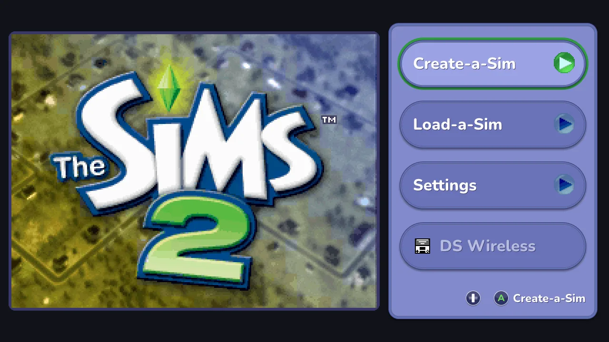

<h1 align="center">The Sims 2 DS, one screen</h1>

  <strong>The Sims 2 for the Nintendo DS, played on your computer like a console game.</strong> 
  One window, a controller in your hands, and every DS menu redrawn sharp and big.

  
  

  

## What you get

- **One window, no more two tiny screens.** The town fills it; the touch screen's menu opens
  big over it on one button.
- **The DS menus in HD, in the game's own style.** Its colours, its icons and its own words:
  pockets, goals, the phone, the shop, the hotel, Create-a-Sim, conversations and popups.
- **Played with a controller only.** Xbox, PlayStation, Switch, 8BitDo, the Steam Deck and the
  Steam Controller. Every minigame works on the buttons too, with hints on screen.
- **Widescreen and sharper 3D**, at 60 frames a second. Each can be switched off.
- **Five languages**: English, French, German, Italian and Spanish, from your copy of the game.
- **Your saves are safe.** The game saves as on the DS, and a backup copy is made every half hour.

## A look around

<table>
  <tr>
    <td></td>
    <td></td>
  </tr>
  <tr>
    <td></td>
    <td></td>
  </tr>
  <tr>
    <td></td>
    <td></td>
  </tr>
</table>

## Get started

1. **Have your own copy of the game.** Dump it from your own cartridge of the European version
   (an `.nds` file). Nothing of the game is included here.
2. **Download** the program for Windows, Mac or Linux from the [releases page](../../releases)
   and unzip it.
3. **Open it** (`sims2wide`, or *Sims 2 DS Wide* on a Mac) and pick your game file. Done: it
   remembers where it was.

The program isn't signed, so the first time Windows wants *More info > Run anyway*, and a Mac a
right click > *Open*.

**On Steam or a Steam Deck:** in Steam, *Add a Game > Add a Non-Steam Game*, pick the program and
keep Steam Input on with the default Gamepad layout.

Want to build it yourself? See [CONTRIBUTING.md](CONTRIBUTING.md#set-up).

## Controls

The buttons on screen always show what they do, with your controller's own labels.

| Controller | Keyboard | Does |
|---|---|---|
| Left stick or D-pad | Arrows | walk; move around menus |
| A / B | X / Z | do, choose / go back, close |
| Back | E | open the menu (pockets, goals, phone…) |
| Start + Back | Esc | pause: save state, settings, quit |
| LB / RB | Q / W | turn the camera; switch menu tabs |
| X / Y | S / A | zoom in / out |
| RT (hold) | Space (hold) | fast forward |
| Minigames | | their buttons are shown in a bar under each one |

The mouse works too: click the touch screen, scroll to zoom, right-drag to turn the camera.
Every button can be changed in the pause menu. The [full manual](docs/manual.md) has every
control, minigame by minigame.

## FAQ

**Which version of the game works?**
The European one. Other versions start, but most menus stay the DS's own small pictures.

**Where is my save?**
Beside your game file, with the same name and `.sav`. Backups go in `backups/` next to it. A save
from another emulator or a flash cart works if you put it there.

**It's blurry, or slow.**
Pause, then *Settings*: *Graphics* sets how sharp the 3D is, and widescreen and 60 fps can be
switched off on a slow computer. If it runs too fast, check you aren't holding fast forward.

**Can I play with a keyboard?**
Yes. Every DS button has a key, and an AZERTY or QWERTZ keyboard has them in the same places.

**Is DS Wireless supported?**
No. Trading and wireless games need a second DS; the game's screen says so and B leaves it.

## Help and contributing

- The [full manual](docs/manual.md): every control, the settings, the layouts and what is still rough.
- Found a bug? [Open an issue](https://github.com/lborruto/sims2-ds-wide/issues) with your
  system and what happened. Never attach a game file, a save or a save state.
- Want to help? [CONTRIBUTING.md](CONTRIBUTING.md). Security: [SECURITY.md](SECURITY.md).
  What changed: [CHANGELOG.md](CHANGELOG.md).

## Licence and credits

GPLv3, see [LICENSE](LICENSE), as melonDS. It runs the game on
[melonDS](https://github.com/melonDS-emu/melonDS) 1.1, with [SDL2](https://www.libsdl.org/),
[stb](https://github.com/nothings/stb) and [tinyfiledialogs](https://sourceforge.net/projects/tinyfiledialogs/).
The font is [Nunito](https://github.com/googlefonts/nunito) ([OFL](assets/fonts/OFL.txt)); the
controller mappings are [SDL_GameControllerDB](https://github.com/mdqinc/SDL_GameControllerDB)
([zlib](assets/controllers/LICENSE.txt)). The idea, the controls, the menu drawing, the sound
stretching and the sharper, widescreen 3D come from
[Pokémon FullDex](https://github.com/mamesj/pokemon-fulldex), GPLv3 too.

## Not affiliated, no warranty

An independent, unofficial project, not made, endorsed or supported by Electronic Arts, Maxis,
Nintendo or the melonDS team; the names are theirs, used only to say what it works with. Bring
your own copy, dumped from a cartridge you own. No warranty: keep a copy of your save.
