# The Sims 2 DS, one screen: the manual

Everything the [README](../README.md) leaves out: how to start, every control, the pause menu
and its settings, the controllers, where your files go, the other layouts and what is still
rough. If you only want to play, the README is enough: the buttons on screen always say what
they do.

- [Starting](#starting)
- [Playing](#playing)
- [The minigames](#the-minigames)
- [The pause menu](#the-pause-menu)
- [Settings](#settings)
- [Controllers](#controllers)
- [Keyboard and mouse](#keyboard-and-mouse)
- [Your saves and files](#your-saves-and-files)
- [Layouts and looks](#layouts-and-looks)
- [Good to know](#good-to-know)

## Starting

You need your own copy of the game, dumped from your cartridge (an `.nds` file). Nothing of the
game is included here. The European version is the one the HD screens are made for (see
[Good to know](#good-to-know)).

**Download** from the [releases page](https://github.com/lborruto/sims2-ds-hd/releases):

| Where you play | Download | Start it |
|---|---|---|
| **Windows** (64-bit) | `sims2-ds-hd-…-windows-x86_64.zip` | unzip, double-click `sims2hd.exe`; the first time, *More info > Run anyway* |
| **Mac** (Apple silicon or Intel, macOS 11+) | `sims2-ds-hd-…-macos-universal.zip` | unzip, move *Sims 2 DS HD* to Applications; the first time, right click > *Open* |
| **Linux** (x86_64) | `sims2-ds-hd-…-linux-x86_64.tar.gz` | unpack, run `./sims2hd` (the file picker needs zenity or kdialog) |

**The launch panel** opens first. *Choose a file* (or drop your `.nds` on the window) starts the
game. Next time, *Continue* picks up exactly where you quit, with a picture of that moment; your
other recent games are listed under it. *Language* sets the game's language (below). A file that
is not The Sims 2 is said right there; another region's cartridge plays, but with the game's own
small screens (said once, until you press A).

<p align="center">
  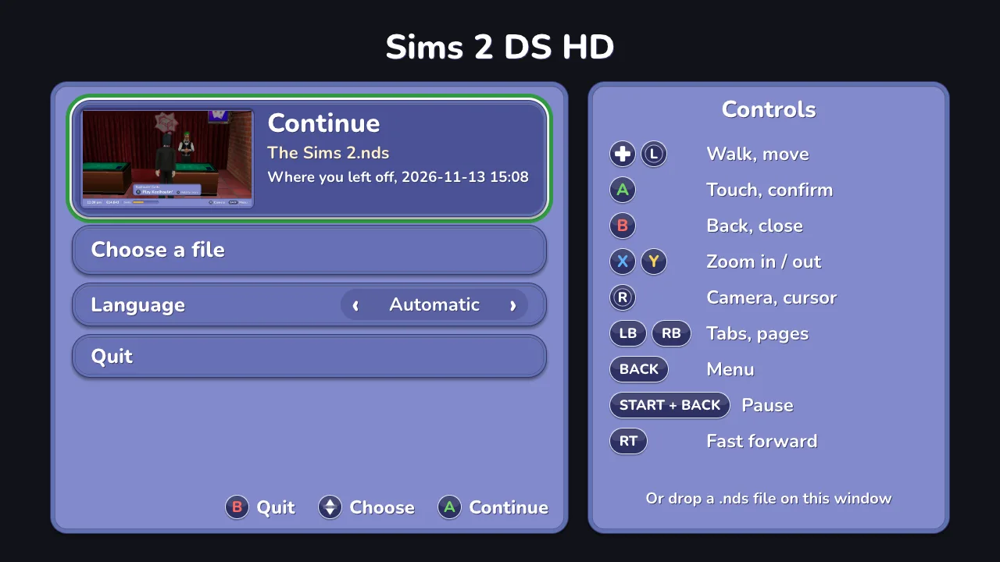
</p>

A ROM on the command line (`sims2hd path/to/your-sims2.nds`) skips the panel.

**The game's language** follows your computer's (English, French, German, Italian or Spanish),
or the one you pick on the launch panel or in the pause menu's Settings. It is the game's own
language, as if your DS were set to it: its text, its keyboards and the HD screens all follow. A
change applies the next time the game starts (*Change game* in the pause menu counts).

**Fast boot** (on by default) runs the boot's splash screens, which wait for no button, at full
speed. The title still waits for you.

**Or build it** (a few minutes):

```bash
git clone --recursive https://github.com/lborruto/sims2-ds-hd.git && cd sims2-ds-hd
cmake -S . -B build -G Ninja -DCMAKE_BUILD_TYPE=Release
ninja -C build sims2hd
./build/sims2hd path/to/your-sims2.nds
```

You need CMake (3.21 or later), Ninja and a C++20 compiler (Xcode's command line tools on a
Mac). On Linux, SDL's development packages too: [CONTRIBUTING.md](../CONTRIBUTING.md#set-up)
lists them.

## Playing

The game is played like a console game: the town fills the window, and everything the DS did
on its touch screen opens big over it, redrawn sharp in the game's own colours, icons and words.
Every screen shows which buttons do what, with your controller's own labels (or your keys, when
you last typed). The mouse works everywhere too.

<p align="center">
  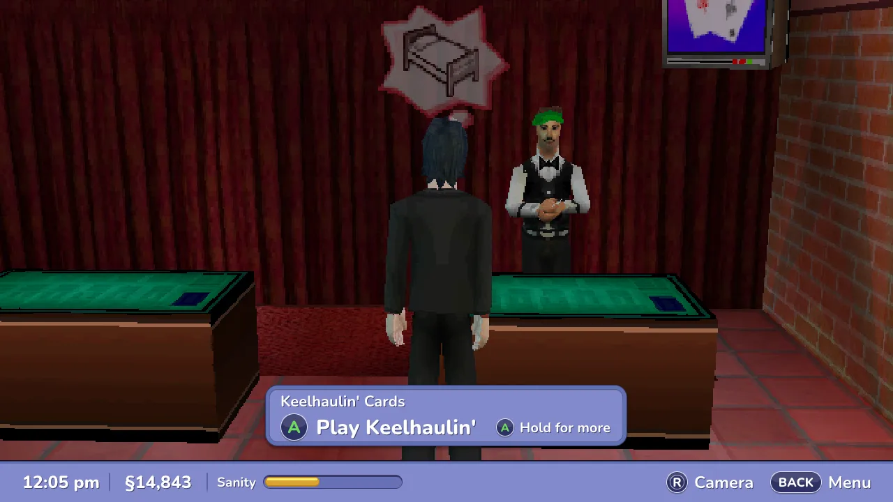
</p>

### In town

- **Walk** with the left stick or the D-pad.
- **The camera** is the right stick: left / right turns it, up / down zooms in and out. (The
  keyboard: Q / W turn, S / A zoom.)
- **What A does here.** Near someone or something you can use, a small plate at the bottom says
  what A does ("A Buy", and who or what). Tap A to do it. Hold A for the other things you can do
  (Up / Down choose, let go to do it); while A is held, Left / Right pick the next person or thing
  nearby. Closing the menu on another tab (Pockets, Goals...) brings the game back to Interact, so
  the plate is there as soon as you walk on.
- **The status bar** runs along the bottom of the window: the time, your money and your Sanity,
  with the camera and menu hints at the right. What you just won (green) or paid (red) shows
  beside the money for a few seconds. The bar stays under conversations too.
- **The menu** (Back, or E) opens the touch screen's menu big over the town: LB / RB switch
  tabs, the D-pad moves, A does, B closes. Every screen's hints say what the D-pad does there
  ("Choose" whenever it moves the highlight), and a list that scrolls has its up and down arrows
  at its right. Lists stop at their ends.

### The menu

- **Interact**: what the person or thing in front of you can do. A does the highlighted action,
  Left / Right pick the next one nearby.
- **Pockets**: your six slots, the tools and the things you collect, with their descriptions
  (what you have none of, a tool not found yet or a collection at 0, is drawn faint). A
  uses the highlighted item. X throws it away, but only on the second press: the first press turns
  the bin green and the hint says "Again"; moving away cancels.
- **Goals** and **Relationships**: Up / Down move through the list; Relationships shows each
  Sim's mood and how they feel about you.
- **Options**: Left / Right turn a volume up or down a notch (every press counts, however fast).
  A on *Save* opens the game's three save slots: A saves into the highlighted one (an empty slot at
  once; a used one asks first, and the question opens on No).
- **The phone** (the top right of the menu): its Up / Down / OK are the D-pad and A, as on the
  phone itself. B goes back one page ("Back": a message to the list, the ringtones to the menu)
  and, from its first page, hangs up ("Close"). Back hangs up from anywhere.

The save slots and the phone, opened from the menu, come back to the menu where you were.

<p align="center">
  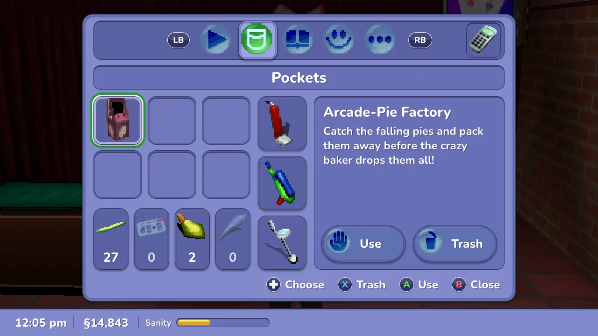
  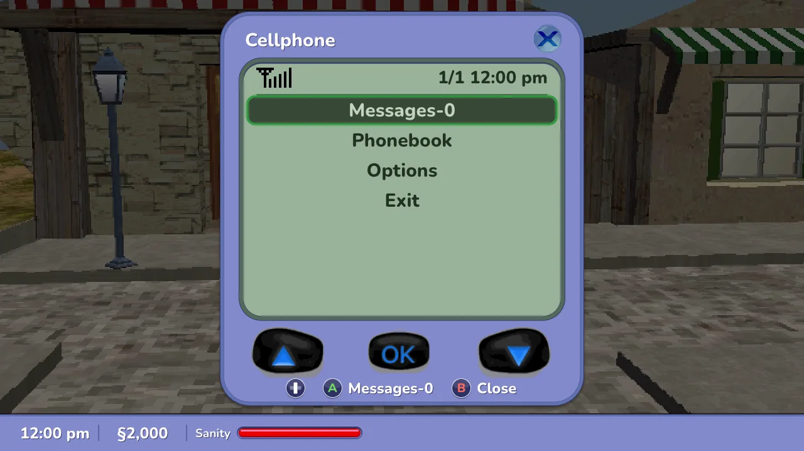
</p>

### Shops, the hotel and the rest

- **Give Gift**: A on an item gives it (or A on the bow gives the selected one); B closes.
- **A shop's catalogue**: A on an item selects it (to buy from the shop, or one of yours to
  sell); A on the simoleon button buys or sells it (it names the item and the price, and is
  greyed when the game would refuse). Up / Down past the list scroll it; B closes.
- **Build Rooms** (City Hall): A on a room shows the permit and what you would have left, then
  asks in a box like every question (the room and the sum in it); the question opens on No, so a
  stray double press never spends. Right then A buys. A permit you cannot pay is red.
- **The hotel's Registry**: A on a room shows its page (who stays, their mood, when they leave,
  what the room earns a day; A on a line explains it). When a guest checks in, A on a free room
  gives it to them.
- **A music panel**: A plays the highlighted song (the room keeps it); Up / Down scroll.
- **The stat panel**: its tabs name the five pages; A opens a page, LB / RB (or Left / Right) go
  to the previous / next one, B goes back ("Back"), then closes ("Close").
- **Conversations** go on with A. **Popups** (tips, goals, Game Paused) close with A or B. A
  **question** (Quit? Overwrite this save?) always opens on No: Right then A says yes, B is always
  no. When a popup opens over the menu, the menu comes back on the same row after it.
- **A note** closes with A or B.

<p align="center">
  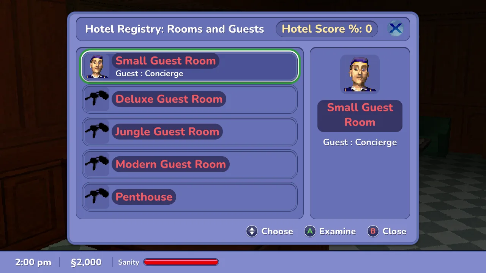
</p>

A few screens still show the game's own touch screen, big, with the right stick as a cursor (A
touches; the hints say so): the furniture editor of a hotel room (B leaves it), the end credits
after the story, and any screen not redrawn yet.

### Before the game

- **The intro and title**: A or Start take the intro's last screen and begin at the title.
- **The main menu**: Up / Down and A pick Create-a-Sim, Load-a-Sim or Settings. DS Wireless is
  greyed: it needs a second DS. The buttons fade in first; a press during the fade does nothing.
- **Settings** (the game's own): LB / RB change page (Music, SFX, Concept Art, Credits), Left /
  Right move a volume by a tenth, A shows an unlocked concept picture big (B puts it away), B goes
  back to the title.
- **Load-a-Sim**: Up / Down pick a slot, A loads it, B goes back.

<p align="center">
  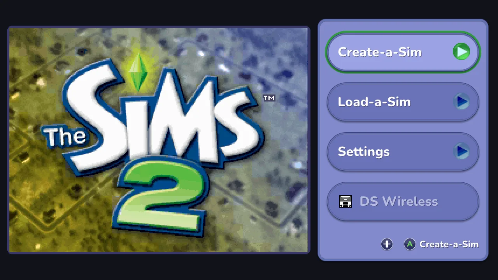
</p>

### Create-a-Sim

Your Sim is big on the left, the game's pages on the right. LB / RB change page, Start goes to
the next one and B back to the one before. The right stick (or the mouse's right drag) turns your
Sim, and so do X / Y after the first page.

- **The name** (the first page): the D-pad and A type it on the game's keyboard, seven letters at
  most; Y erases a letter and X changes the letters (ABC, abc, 123!). With the highlight on the
  keyboard you can also type on your computer's keyboard (Enter is A, Backspace erases). The
  gender and skin buttons are above it.
- **Hair, face and clothes** are picked with the D-pad and A; Left / Right past the edge show
  more, as the game's arrows do.
- **Keep this Sim?**: pick an aspiration, then A on the tick (or Start) starts the game. B first
  moves to the cross and only a second B presses it, so one stray B never throws your Sim away.
  B on the name page takes you there, onto the cross: the way back to the title.

## The minigames

Every minigame is played on the buttons, big, in its own frame: the game's name, its numbers
(scores, earnings, health, charge, water and pressure…) at the right and a bar of hints at the
bottom that follows what the game asks. Their messages (a win, the end of a turn, a help text) are
redrawn too, and a question opens on No (Right then A for yes, B is always no). The pointing games
have a pointer on the sticks (LT slows it).

<p align="center">
  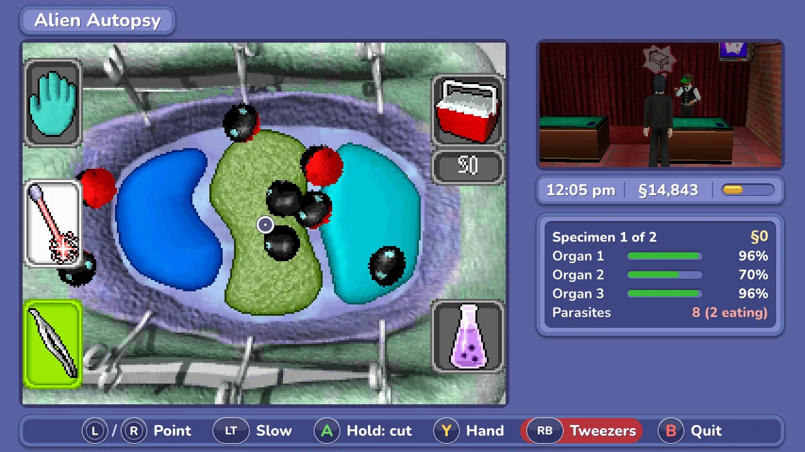
  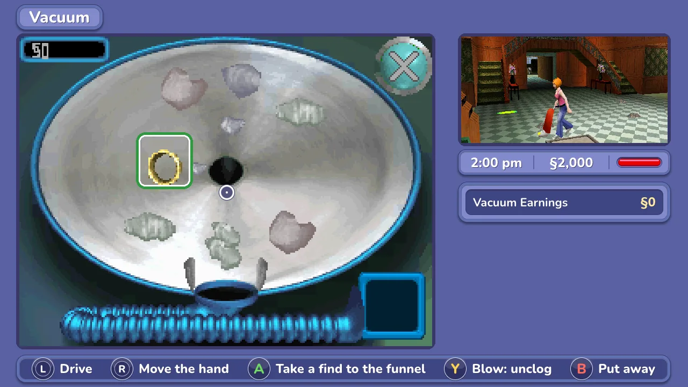
</p>

| Minigame | Controller | Keyboard | Does |
|---|---|---|---|
| Social reaction | D-pad or left stick | Left / Up / Right | the left / top / right answer |
| | A | X | the chosen answer again |
| Keelhaulin' Cards | D-pad or left stick | Arrows | choose a card (or the deck, the discard pile, ? and X) |
| | A | X | pick the card up; again: play it on the stairs |
| | X | S | draw from the deck |
| | Y | A | discard the chosen card |
| | B | Z | quit (it asks: No first) |
| Vacuum | left stick (or D-pad) | Arrows | drive |
| | right stick | S + arrows (or drag with the mouse) | move the hand over the bowl (a green ring shows the find nearest it) |
| | A | X | take the ringed find to the funnel at the bowl's bottom (kept; dust left alone) |
| | Y | A | blow: clears a clogged filter |
| | B | Z | put the vacuum away |
| Alien Autopsy, painting | either stick (LT: slow), D-pad | Arrows | move the pointer (the D-pad a pixel at a time, faster held) |
| | A (hold) | X (hold) | the stylus down: cut, lift an organ, pick a parasite, paint |
| Alien Autopsy | X / Y / RB | S / A / W | laser / hand / tweezers |
| | A (the hand, an organ cut free) | X | take the freed organ to the tray by itself |
| | A (the tweezers) | X | take the nearest parasite (an eating one first) to the flask by itself |
| | LB | Q | carry the organ to the tray (the parasite to the flask) |
| | B twice | Z twice | quit (the game pays nothing then) |
| Metal Detector | left stick or D-pad | Arrows | walk |
| | A / B | X / Z | dig / switch it off |
| | LB / RB, right stick | Q / W | depth |
| Painting | LB / RB | Q / W | the previous / next tool |
| | X / Y | S / A | the next colour / undo |
| | Back | E | the next palette (16 of them) |
| | B / Start | Z / Enter | done (it asks: No first) |
| Moogoo Monkey | D-pad or left stick | Left / Right | choose the monkey to bet on, the card to play, the monkey a special card goes on (a green ring shows it) |
| | A | X | bet, play the card; otherwise go on |
| | B | Z | take the bet or the card back; else quit (it asks) |
| | Start | Enter | quit (it asks: No first), also while a bet or a card is chosen |
| Super Drencher | left stick or D-pad | Arrows | walk |
| | A (hold) / X (hold) | X / S (hold) | fire / pump |
| | Y / RB / LB | A / W / Q | target / refill / run |
| | B | Z | put it away |
| | Start | Enter | the game's help: a button then shows what it does |
| Rat-A-Rang | left stick or D-pad | Arrows | walk |
| | X / Y | S / A | scare / subdue |
| | A (hold) + a stick | X (hold) + arrows | aim; let go to throw |
| | LB / B | Q / Z | run / put it away |
| Scratch ticket | either stick (LT: slow), D-pad | Arrows | move the pointer |
| | A (hold) / X | X (hold) / S | scratch / scratch the box under the pointer for you |
| | B twice | Z twice | quit (the ticket is lost) |
| Music mixer | either stick (LT: slow) | the mouse | move the pointer |
| | A (hold) | X (hold) | press a key, a button, a slider |
| | D-pad (hold) | Arrows (hold) | Up / Down: an octave; Right: sustain; Left: PREP |
| | X / RB / LB | S / W / Q | PLAY, RECORD, GENRE (B stops) |
| | Y (hold) | A (hold) | record your voice (VOX) |
| | B / Start | Z / Enter | quit / the game's help |
| Saving a song | D-pad, A, Y, B | Arrows, X, A, Z | choose, type or save into a slot, erase, back |

The slot machine, the skydive and the arcade cabinets are animations: the world shows big, with
what you won beside the status bar.

## The pause menu

**Start + Back** together (press Back first: Start first may open a minigame's help on its way)
or **Esc** pauses the game and opens the pause menu, in the game's look and your language. The
same buttons go back to the game from any of its pages (over a question they say No). Lists stop
at their first and last rows; the hints at the bottom say what each button does there.

- **Resume** (or B).
- **Settings**: every option, in five tabs, below.
- **Controls**: what each button does, and *Keys and buttons* to change them (the pause menu
  too: one button alone can open it): A on an action,
  then the key or button you want (Esc, or Start + Back together, keeps what it had; Backspace
  leaves it no key); X clears it, Y sets them all one after another; the last row resets them all
  (it asks first). The pause menu always keeps a key: clearing it is refused, with a message. The
  Controls page shows the buttons of what you used last: on the keyboard the arrows, Q / W and
  the mouse; on a pad the sticks and LB / RB.
- **Save states**: four slots, each with a picture and the date. A on a used slot loads it (it
  asks first), A on an empty one or X saves (X on a used one asks first). *Undo the last load*
  takes you back to just before a load, even after a restart (it asks first). A state made with another ROM file says so before loading.
- **Change game**: keeps your place (as Quit does), then back to the launch panel.
- **Open the saves folder**: the folder with your save states, screenshots and settings.
- **Quit** asks first (the question opens on No) and keeps your place: *Continue* on the launch
  panel picks up right there. If the game saved after that (on another computer, say), Continue
  starts from the game's own save instead and says so.

Closing the window asks the same question. Every question opens on No, and B is No; a message
closes with A or B.

<p align="center">
  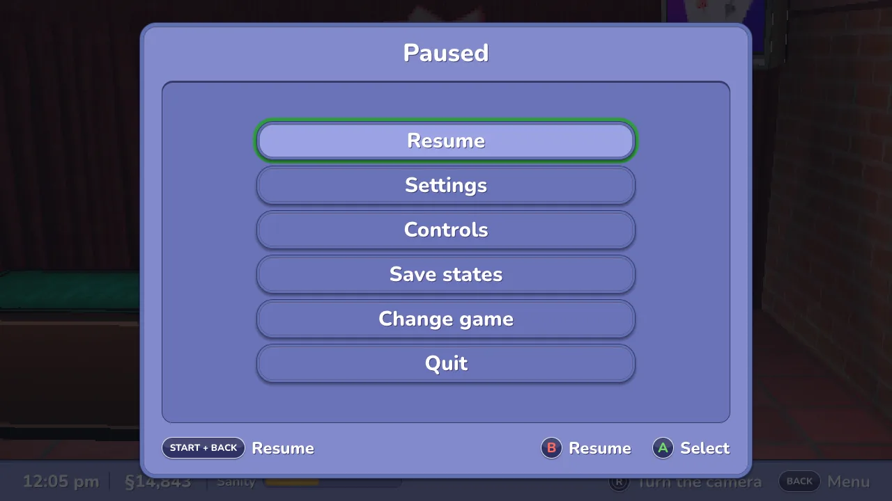
  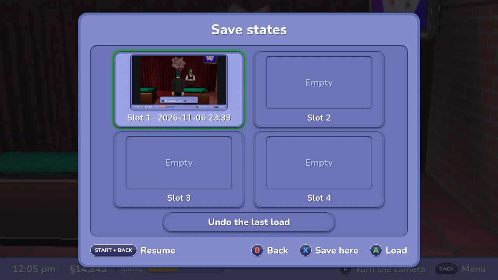
</p>

F5 and F7 save and load one more quick state, without the menu.

## Settings

The pause menu's Settings has five tabs: **LB / RB** (Q / W on the keyboard) go from one to the
next, Up / Down move in the tab, Left / Right (or A) adjust the highlighted row, whose `‹ ›`
arrows say it can change. The line under the list says what the highlighted row does. Each tab
puts the rarely needed rows last, under *Advanced*. **Y** puts the tab's rows back to their
defaults (it asks first, on No); window size and place and your keys and buttons are not touched.
Everything is kept between runs.

<p align="center">
  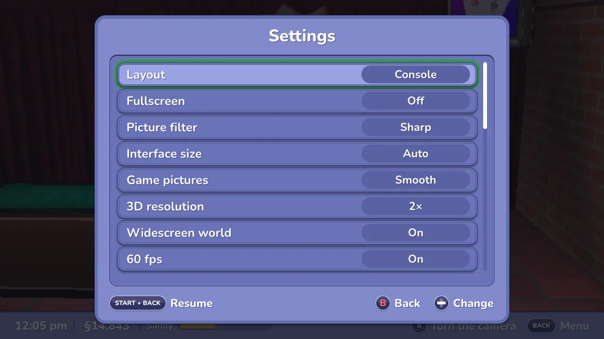
</p>

**Display**

| Setting | What it does |
|---|---|
| Fullscreen | also F11 |
| Interface size | the size of the HD menus, conversations and hints. Auto (the default) follows your screen's size and the window's, so they are not huge on a big monitor nor tiny on a handheld; or 60 to 150 % by hand. 100 % is the menus' largest size at 16:9 (they already fill the screen's height); larger sizes grow the hints, the world's prompts and conversations. The game's world keeps its size |
| Screen scaling | how the game's pictures are scaled to your window: Sharp (crisp, evenly sized pixels at any size: the default), Smooth or Pixels |
| Game icons | the game's icons and portraits in the HD menus: Pixels (the DS's own, the default) or Smooth (redrawn with soft edges by the xBRZ scaler) |
| Hide the idle pointer | the mouse pointer hides after a few seconds still over the game |
| *Advanced:* Layout | Console (the default) or one of the older layouts ([below](#layouts-and-looks)) |

**Graphics**

| Setting | What it does |
|---|---|
| Battery saver | the 3D at the DS's own 192p and 30 fps whatever the two rows below say: lighter on a laptop's battery and fans. While it is on, those two rows are dimmed and show what it holds them at |
| 3D resolution | how sharp the 3D world is drawn: DS (192p, the DS's own), 384p (the default), 576p, 720p, 1080p or 1440p. The high ones need a fast computer |
| 60 fps | in-between frames for the 3D, which the game draws at 30 a second (default on) |
| *Advanced:* Widescreen world | more of the town left and right, 16:9 instead of 4:3 (default on) |

**Sound**

| Setting | What it does |
|---|---|
| Volume | all the game's sound, by 5 %. Music and effects have their own volumes in the game's own options |
| Mute | silence without losing the volume |
| Pause in the background | on (the default): the game pauses and goes quiet while its window is not in front |
| *Advanced:* Sound in fast forward | muted, or at normal pitch skipping ahead |

**Controls**

| Setting | What it does |
|---|---|
| Keys and buttons | opens the page that changes them (the same as the pause menu's Controls). The pause menu can have one button of its own there instead of Start + Back |
| Stick cursor | the right stick as a cursor on the touch screen where one is needed |
| Cursor speed | 50 to 200 %: the cursor's and the minigames' pointer |
| Swap the sticks | left-handed: the camera and the cursor go to the left stick, walking to the right |
| *Advanced:* Stick dead zone | raise it if your Sim walks on its own |
| *Advanced:* Trigger press at | how far a trigger goes down to count |
| *Advanced:* Buzz on connect | a short buzz when a controller connects (the game itself has no rumble) |

**Game**

| Setting | What it does |
|---|---|
| Language | the game's language and the HD screens' ([above](#starting)); applies at the next start, as the row says |
| Microphone | what the DS hears when the game listens (the vacuum, the music mixer): off, the blow key (M) or your real microphone; in Console the vacuum's Y blows whatever this says |
| Fast forward speed | 2×, 3×, 4× or as fast as it goes |
| Fast forward key | Hold, or Toggle (pressed once on and once off) |
| *Advanced:* Fast boot | the boot's splashes at full speed (default on) |

## Controllers

Plug in any controller, before or during the game: Xbox (and every XInput pad), PlayStation 3 /
4 / 5, Switch Pro and Joy-Cons, 8BitDo and the many others SDL knows, by USB or Bluetooth, on
Windows, Mac and Linux. Several can be plugged in: whichever you touched last plays. The keyboard
always works beside them. The Guide / PS / Home button stays your system's (and Steam's): the
pause menu is Start + Back. A controller plugged in says so at the top of the window, with how
to pause.

**Steam and the Steam Deck.** In Steam, *Add a Game > Add a Non-Steam Game*, pick
`sims2hd.exe` (or `sims2hd` on Linux and the Deck) and leave Steam Input on with its default
*Gamepad* layout. To skip the launch panel, put the ROM's path in the game's *Properties >
Launch Options*, in quotes: `"C:\Games\Sims 2.nds"`. The pad shows up as an Xbox controller, so
the buttons are labelled the Xbox way; the Steam Controller's right pad works as the right stick.
The Deck fills its 1280 × 800 screen with thin bars above and below. The Steam overlay does not
pause the game: open the pause menu first. Without Steam, the Steam Controller is read directly
only with the environment variable `SDL_JOYSTICK_HIDAPI_STEAM=1` set and Steam closed (a running
Steam fights over the pad); its back grip then stands for the right pad's click. The Deck's own
controls work without Steam too.

**A controller that does nothing** has no mapping yet: the program says which one in its terminal
output. Make one with [SDL2 Gamepad Tool](https://generalarcade.com/gamepadtool/) or Steam's
controller settings and put the line in `gamecontrollerdb.txt` in the settings folder
([below](#your-saves-and-files)); a mapping in the `SDL_GAMECONTROLLERCONFIG` environment
variable (what Steam sets) wins over it. A controller SDL already knows keeps SDL's own mapping;
the built-in [SDL_GameControllerDB](https://github.com/mdqinc/SDL_GameControllerDB) only adds the
others.

## Keyboard and mouse

The DS's buttons sit by position, not by letter, so an AZERTY or QWERTZ keyboard has them in the
same places as QWERTY. Every key and button can be changed in the pause menu.

| Key | Controller | Does |
|---|---|---|
| Arrows | D-pad or left stick | walk; move the highlight |
| X / Z / S / A (AZERTY: X / W / S / Q) | A / B / X / Y | the DS's A / B / X / Y |
| Q / W (AZERTY: A / Z) | right stick left / right | turn the camera in town |
| S / A | right stick up / down | zoom in / out in town |
| Q / W | LB / RB | switch tabs and pages in the menus |
| Enter / Right Shift | Start / left stick click | the DS's Start / Select |
| E | Back | open the menu |
| Esc | Start + Back | the pause menu (and back to the game from any of its pages) |
| Space (hold) | RT (hold) | fast forward |
| (the mouse's click) | LT (hold) | press with the stick cursor on the touch screen |
| M (hold) | | blow into the microphone (Y does it in Console) |
| F5 / F7 | | quick save state / load it |
| F11 / F12 | | fullscreen / screenshot of the window |
| Tab | right stick click | swap which screen is big (the older layouts) |
| 0 to 4 | | layout: Auto / Focus / Side by side / Stacked / Console |

**The mouse** is the stylus: click the touch screen's pictures wherever they are shown, or any HD
button (it does what A does there). Over the world, the wheel zooms and a right-button drag turns
the camera.

## Your saves and files

- **The game's own save** goes beside your ROM, with the same name and `.sav`, as on a flash
  cart: a `.sav` from another emulator or a flash cart works if you put it there. A copy is made in
  `backups/` beside it when the program starts and every half hour (the last eight are kept).
- **When the ROM's folder cannot be written** (a read-only drive, a protected folder), the game
  saves to `saves/` in the settings folder instead, and the pause menu says where. Once the ROM's
  folder can be written again, the newer save goes back beside the ROM by itself.
- **The settings folder** (also *Open the saves folder* in the pause menu): on Windows
  `%APPDATA%\sims2-ds-hd`, on a Mac `~/Library/Application Support/sims2-ds-hd`, on Linux
  `~/.local/share/sims2-ds-hd`. It holds `settings.ini` (delete it to start over), the save
  states and the place kept when you quit (`states/`), your recent games, screenshots
  (`screenshots/`, F12) and `gamecontrollerdb.txt` if you add one.
  Coming from a version called sims2-ds-wide (0.1.x)? The first time it opens, the program moves
  that folder's content (`sims2-ds-wide` beside it) over by itself; a file the new folder already
  has stays in the old one.
- **A save state holds a copy of the game's memory**: never share one, nor attach one to an issue.

## Layouts and looks

**Console** is the default and what this manual describes. The older layouts show the DS's own
two screens and are chosen by hand (the pause menu's Settings, the 0 to 4 keys, or `--layout`
on the command line):

| Layout | What you see |
|---|---|
| **Console** (default) | the game played like a console game: everything above |
| **Auto** | Focus in town (the touch screen big during a social game, in the shop's catalogue or Build Rooms), Side by side everywhere else |
| **Focus** | the world big, the touch screen at twice its size over the world's right edge, a little see-through (Tab swaps them) |
| **Side by side** | both screens side by side |
| **Stacked** | as on the DS, one above the other |

**Looks.** Sharper 3D, the widescreen world and 60 fps are on by default (Settings; Battery
saver holds the 3D at the DS's own 192p and 30 fps, and leaves the widescreen as it is). Widescreen is a stretch for a game made for 4:3: the game is told to
draw a wider view, and it does in town, in conversations and in Create-a-Sim, but in places not
checked yet something the game never meant to be seen can show at the edges. Switch it off if a
place looks odd. All three together still run well over full speed on a recent computer.

`sims2hd --help` lists every command line option, including the headless mode used to study the
game's screens ([CONTRIBUTING.md](../CONTRIBUTING.md#studying-the-screens)).

## Good to know

- **The HD screens need the European game** (code `ASJP`): they read what the game shows from its
  memory, and that map is the European one. Another version starts and plays, with the game's own
  small screens, and the program says so once. A save from the American game loads in the
  European one.
- **What was played, and what only from test states.** Town, conversations, Create-a-Sim, the
  shops, Build Rooms, the hotel, the social games, the vacuum and the casino's cards were played.
  The Alien Autopsy, the Metal Detector, the painting, Moogoo Monkey, the Rat-A-Rang, the scratch
  tickets and the music mixer were checked from test states (Moogoo opens on Monkey Day, the
  Rat-A-Rang with the Ratticator's costume); the slot machine, the skydive and the arcade cabinets
  were not reached in play. If one looks wrong, please say so in an issue.
- **No wireless play.** Trading, and Moogoo or the cards with a second DS, need two consoles: the
  wireless screen says so and B leaves it.
- **The game's clock is your computer's.** The game lives by the time of day (rooms take real
  hours, skill points come at set hours), so it reads your computer's time, also after a save
  state, and fast forward never runs it ahead: the game never sees its clock go back.
- **When the computer falls behind**, the sound stretches instead of crackling.
- **Not signed by Apple or Microsoft.** Hence the extra click the first time. Each download comes
  with a build attestation from GitHub instead ([SECURITY.md](../SECURITY.md)).
- **Screens it does not know yet.** When the game shows a screen the program has no name for, it
  frames it as best it can and, once for that screen, saves a picture and a save state into a
  `captures` folder in the settings folder (at most 20 a run, 200 in all). If you see odd screens,
  send the `.png` files and what you were doing in an
  [issue](https://github.com/lborruto/sims2-ds-hd/issues). Never send the `.st` files.
